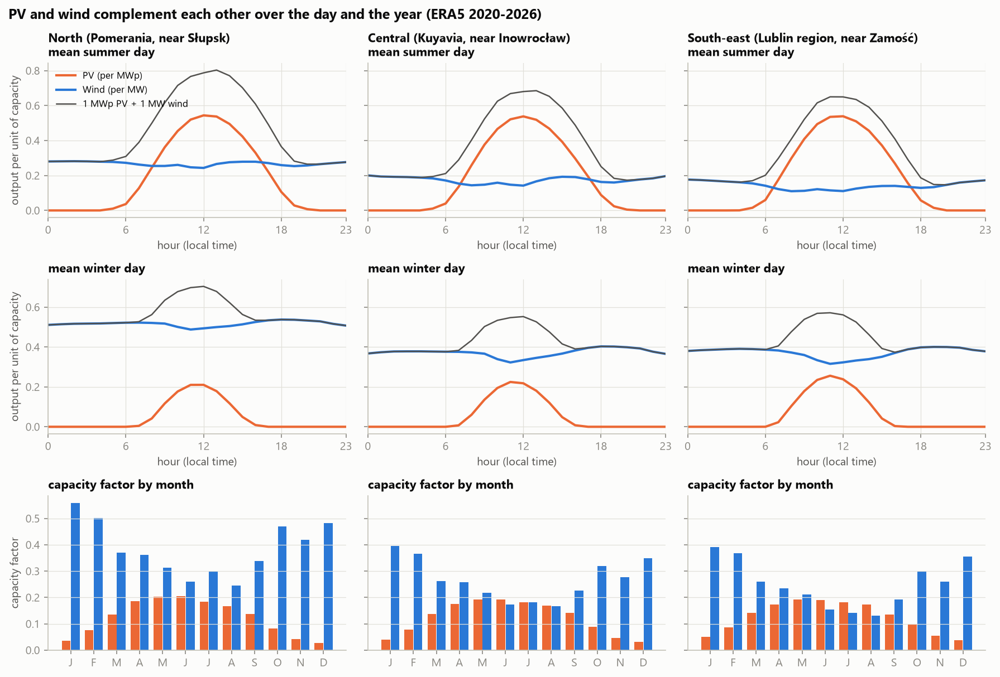
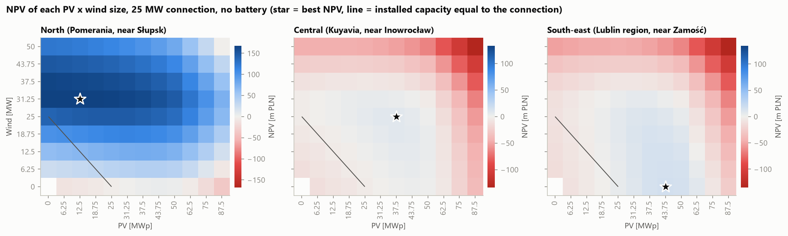
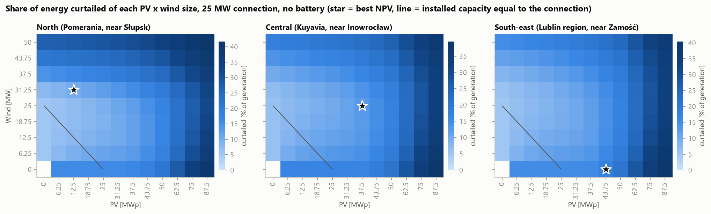
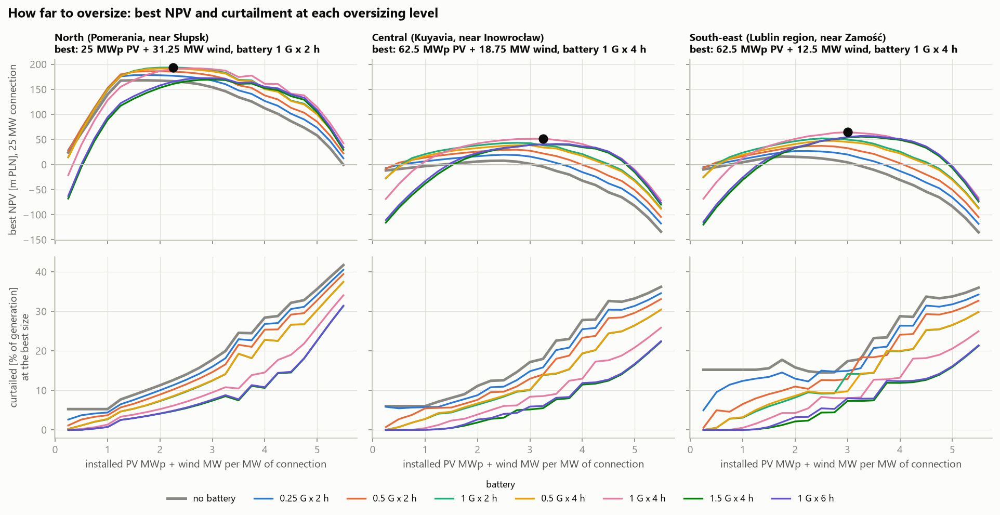
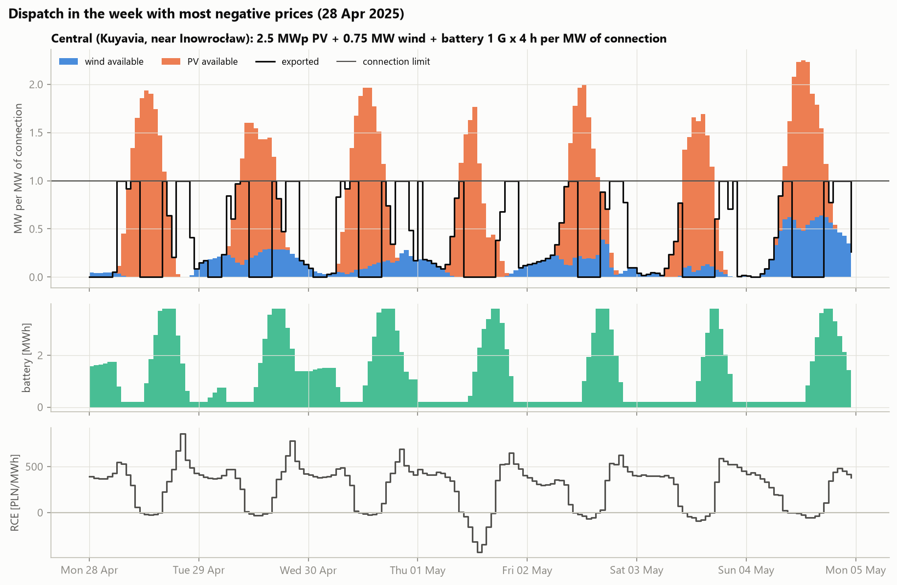

# How much PV, wind and storage fits behind one grid connection? Cable pooling in Poland


Grid connections are one of the main bottlenecks for new renewables in Poland, and many applications are
refused for lack of grid capacity. **Cable pooling** lets several plants share one connection, so
the question becomes how much PV, wind and battery storage to build behind a connection of **G MW**, given that
the power injected into the grid can never exceed G. This repository answers it with a transparent model on
open data:

- hourly **PV and wind profiles** for three Polish locations from ERA5 reanalysis (pvlib for PV, an empirical
  Senvion MM92 power curve for wind),
- two years of **RCE prices** from the public PSE API (October 2024 - September 2026),
- a **linear program** (HiGHS) for every size combination that decides hour by hour what to export, what to
  store and what to curtail, with perfect foresight, so the result is an upper bound,
- **NPV, LCOE and curtailment** for 856 PV x wind x battery combinations per site and three connection sizes,
  shown as heatmaps, an oversizing frontier and an [interactive dashboard](https://kwwaleszczynski-del.github.io/cable-pooling-sizer/).

> **All costs and financial parameters are illustrative assumptions taken from public sources (see
> [Assumptions](#assumptions)). The numbers show how the trade-offs behave; they are not investment advice and
> not a valuation of any real project.**

## Key results

Three illustrative ERA5 grid points: **North** (Pomerania, near Słupsk, 54.45 N 16.95 E), **Central** (Kuyavia,
near Inowrocław, 52.75 N 18.25 E) and **South-east** (Lublin region, near Zamość, 50.70 N 23.25 E). Prices: RCE,
1 October 2024 - 30 September 2026 (mean 470 PLN/MWh, 716 hours below zero). Tables for a **25 MW connection**;
the best ratios are the same for 10 and 50 MW (see [Scale](#scale)).

### PV and wind complement each other, and the market pays them very differently

| Site | PV yield | Wind CF | Correlation PV vs wind (hourly / daily / monthly) | PV capture rate | Wind capture rate | PV energy produced at negative prices |
|---|---|---|---|---|---|---|
| North | 1,079 kWh/kWp | 38.5 % | -0.15 / -0.34 / -0.75 | 57 % | 91 % | 16 % |
| Central | 1,071 kWh/kWp | 26.7 % | -0.16 / -0.30 / -0.70 | 57 % | 87 % | 16 % |
| South-east | 1,102 kWh/kWp | 25.1 % | -0.18 / -0.30 / -0.71 | 60 % | 91 % | 15 % |

Yield (at the connection point, per kWp DC) and capacity factor: ERA5 2020-2025 (full years). Capture rate:
generation-weighted RCE divided by the average RCE, over the price window.

- Wind blows more at night and in winter, PV produces at midday in summer: the correlation is weakly negative
  hour by hour and strongly negative month by month. A plant with 1 MWp of PV and 1 MW of wind on a 1 MW
  connection would exceed the connection in only 2.5-6.7 % of hours.
- **PV earns 57-60 % of the average price**, wind 87-91 %: PV floods the market at midday and 15-16 % of its
  energy falls into hours with negative RCE.



### How far to oversize

Best configuration per site (highest NPV), without a battery and with the best battery option:

| Site | Battery | PV | Wind | Installed / connection | Curtailed (grid-limited / price-driven) | Connection utilisation | NPV | LCOE [PLN/MWh] | Capture price [PLN/MWh] |
|---|---|---|---|---|---|---|---|---|---|
| North | none | 12.5 MWp | 31.25 MW | 1.75 x | 10.1 % (4.3 / 5.8) | 48 % | 168 m PLN | 309 | 447 |
| North | 25 MW / 50 MWh | 25 MWp | 31.25 MW | 2.25 x | 8.4 % (4.2 / 4.3) | 54 % | 194 m PLN | 352 | 495 |
| Central | none | 37.5 MWp | 25 MW | 2.50 x | 12.6 % (4.0 / 8.6) | 39 % | 8 m PLN | 397 | 405 |
| Central | 25 MW / 100 MWh | 62.5 MWp | 18.75 MW | 3.25 x | 8.6 % (6.1 / 2.5) | 44 % | 52 m PLN | 465 | 512 |
| South-east | none | 43.75 MWp | 0 MW | 1.75 x | 17.7 % (3.8 / 13.9) | 19 % | 16 m PLN | 315 | 349 |
| South-east | 25 MW / 100 MWh | 62.5 MWp | 12.5 MW | 3.00 x | 8.0 % (5.6 / 2.4) | 39 % | 65 m PLN | 460 | 526 |

"Installed / connection" is (PV MWp + wind MW) / G. Utilisation: exported MWh / (G x 8,760 h). The capture
price with a battery includes the energy it shifts to expensive hours.

- **Oversizing pays at every site.** Without a battery the best plant has 1.75-2.5 times the connection
  capacity installed, with a battery 2.25-3.25 times. The optimum is flat near the top (see the frontier below),
  so the range of good designs is wide.
- **Accepting 8-18 % curtailment is optimal.** The last MW added is worth building as long as the extra energy it
  sells covers its cost, even when a growing share of its output is cut.
- **Negative prices, not the connection, cause most of the curtailment of PV-heavy plants.** Without a battery,
  8.6 of the 12.6 curtailed percentage points in Central and 13.9 of 17.7 in the South-east come from hours with
  negative prices. A PV-only plant smaller than its connection still curtails 15-16 % of its energy.
- **Wind makes the North; PV dominates elsewhere.** At 38.5 % capacity factor wind carries the northern project;
  with a 25 % capacity factor in the South-east, wind does not pay without a battery and the best plant is
  PV only.





The frontier shows the best NPV reachable at each oversizing level, for every battery option, and the
curtailment of that best plant:



### Does the battery pay?

**At the assumed costs and with the 2024-2026 price spreads repeated for 25 years, yes**, and it is the least
robust result of the study.

- The best battery is **1 MW and 4 MWh per MW of connection** in Central and the South-east; in the wind-heavy
  North 1 MW and 2 MWh is marginally better (by 1.6 m PLN). Larger options (1 G x 6 h, 1.5 G x 4 h) are worse at
  all three sites, so the optimum lies inside the search grid.
- Added to the best plant without a battery (PV and wind sizes unchanged), the best battery raises NPV by 24 m PLN
  (North, 25 MW / 50 MWh, 42.5 m PLN CAPEX), 38 m PLN (Central) and 29 m PLN (South-east; 25 MW / 100 MWh,
  77.5 m PLN CAPEX), at 260-335 full cycles per year. Re-sizing PV and wind around it adds more: 26-48 m PLN over
  the best plant without a battery.
- The battery turns cheap midday PV into evening sales and cuts price-driven curtailment by a third (North) to
  four fifths (South-east); it also makes wind attractive in the South-east.
- With **prices 20 % lower** the battery gain falls to 0.7-5 m PLN and the best battery shrinks to 0.25-1 G x 2 h,
  see [Sensitivity](#sensitivity). Perfect foresight also overstates what a real operator would earn.



### Sensitivity

Best configuration on a 25 MW connection (PV MWp + wind MW, battery, NPV in m PLN) when one assumption changes.
Economics only: the dispatch is not re-optimised (for lower prices this makes the battery result a lower bound).

| Case | North | Central | South-east |
|---|---|---|---|
| base | 25 + 31.25, 1 G x 2 h, **194** | 62.5 + 18.75, 1 G x 4 h, **52** | 62.5 + 12.5, 1 G x 4 h, **65** |
| discount rate 5 % | 43.75 + 31.25, 1 G x 4 h, **319** | 62.5 + 25, 1 G x 4 h, **148** | 62.5 + 25, 1 G x 4 h, **158** |
| discount rate 9 % | 12.5 + 31.25, 1 G x 2 h, **112** | 50 + 0, 1 G x 4 h, **-2** | 62.5 + 0, 1 G x 4 h, **13** |
| PV CAPEX -20 % | 50 + 31.25, 1 G x 4 h, **212** | 75 + 12.5, 1 G x 4 h, **85** | 75 + 6.25, 1 G x 4 h, **99** |
| wind CAPEX -20 % | 18.75 + 37.5, 1 G x 2 h, **242** | 50 + 31.25, 1 G x 4 h, **89** | 50 + 31.25, 1 G x 4 h, **95** |
| battery CAPEX -30 % | 31.25 + 31.25, 1 G x 4 h, **224** | 75 + 12.5, 1.5 G x 4 h, **88** | 75 + 6.25, 1.5 G x 4 h, **104** |
| prices -20 % | 6.25 + 31.25, 0.5 G x 2 h, **70** | 6.25 + 0, 0.25 G x 2 h, **-15** | 43.75 + 0, 1 G x 2 h, **-9** |

- The optimal oversizing moves with the cost of capital: 1.75-2.5 times at 9 %, 3-3.5 times at 5 %. At 9 % no
  plant in Central has a positive NPV.
- **The price level matters most.** With prices 20 % lower only the windy North stays profitable; in Central and
  the South-east no size combination has a positive NPV.
- Revenue of the best plants was 13-16 % higher in October 2025 - September 2026 than a year earlier (average RCE
  500 vs 440 PLN/MWh), a reminder of how short a two-year price window is.

### Scale

The dispatch scales linearly with the connection, so the best ratios are identical for 10, 25 and 50 MW; only
the fixed part of the grid connection cost differs. NPV per MW of connection (best plant with battery):

| Connection | North | Central | South-east |
|---|---|---|---|
| 10 MW | 7.4 m PLN/MW | 1.7 m PLN/MW | 2.2 m PLN/MW |
| 25 MW | 7.7 m PLN/MW | 2.1 m PLN/MW | 2.6 m PLN/MW |
| 50 MW | 7.9 m PLN/MW | 2.2 m PLN/MW | 2.7 m PLN/MW |

The [dashboard](https://kwwaleszczynski-del.github.io/cable-pooling-sizer/) shows every heatmap (NPV, LCOE,
curtailment, utilisation, capture price) for each site, connection size and battery option.

## What cable pooling means in Polish law

*Short summary for context, not legal advice. These rules have changed several times since 2023 and keep
changing; check the current consolidated text of the Energy Law (ISAP) and the operator's connection conditions.*

- **2023: renewables only.** The act of 17 August 2023 amending the RES Act added **art. 7 ust. 1f** to the
  Energy Law (*Prawo energetyczne*). From **1 October 2023** two or more renewable installations may be connected
  at one connection point to a network above 1 kV (*zbiorcze przyłącze*), of the same or different types (for
  example wind and PV). The connection capacity (*moc przyłączeniowa*) caps what is injected, so the installed
  capacity behind it may be larger and the owners must curtail or store the excess. A battery could share the
  connection only as part of a renewable installation, not on its own.
- **2026: any technology and storage.** The act of 13 March 2026 amending the Energy Law (the "grid act",
  draft UC84), in force since **30 April 2026**, extended art. 7 ust. 1f to installations of any generation
  technology and to energy storage. Adding an installation or a storage unit to a connection that is already
  agreed requires no further connection advance payment if the connection capacity does not increase.
- **Open points** at the time of writing: eligibility of shared-connection projects for support schemes
  (auctions, FIP) under the RES Act (a further amendment, draft UC118, was in consultation in 2026) and
  differing interpretations by network operators.

Sources: [KPMG legal alert, April 2024](https://kpmg.com/pl/pl/wiedza/prawo/legal-alert-cable-pooling-podsumowanie-na-pierwsze-polrocze-obowiazywania-nowych-przepisow.html),
[DZP legal alert on the 2026 amendment](https://www.dzp.pl/files/shares/Alerty/Alert%20prawny%20Nowelizacja%20PrEnerg%20POL.pdf),
[gramwzielone.pl, April 2026](https://www.gramwzielone.pl/?p=20356292) (URE: 130 cable pooling applications for
about 1.6 GW in 2024).

## Method

### Generation

**PV** (fixed tilt 30 deg, south, DC/AC ratio 1.2): solar position at the middle of each hour, DNI from ERA5
GHI and DHI (at most 1.1 times the Ineichen clear-sky DNI for solar zenith 80-88 deg, zero beyond, so that
near-horizon hours cannot produce beam spikes), Perez transposition, physical incidence angle modifier, SAPM cell
temperature, PVWatts DC model (temperature coefficient -0.35 %/K) and the PVWatts inverter (98 % nominal
efficiency with its part-load curve) clipped at its AC rating. Output is counted at the connection point, after
flat losses for everything not modelled physically:

| Loss | Value | Source |
|---|---|---|
| DC: soiling 2 %, shading 3 %, mismatch 2 %, wiring 2 %, connections 0.5 %, light-induced degradation 1.5 %, nameplate 1 % | 11.4 % | default losses of NREL PVWatts v5 (Dobos, NREL/TP-6A20-62641, 2014), without availability |
| AC, inverter to connection point: MV step-up transformer about 0.8 %, LV and MV cables about 1 % | 2 % | transformer: load and no-load loss limits of EU Regulation 548/2014 (Tier 2) for a 2.5 MVA liquid-immersed unit, applied to the hourly PV profile; cables assumed |
| Availability | 3 % | PVWatts v5 default |

1 MWp therefore delivers at most 0.79 MW at the connection point (1 / 1.2 x 0.98 x 0.97).

**Wind**: ERA5 wind speed at 100 m (hub height 100 m; other heights are extrapolated with the hourly shear
exponent between 10 m and 100 m) through an **empirical Senvion MM92 power curve** (2.05 MW, rotor 92.5 m):
the mean of the six turbines' 2017 binned curves from the open Kelmarsh SCADA data, computed in
[wind-power-curve-kelmarsh](https://github.com/kwwaleszczynski-del/wind-power-curve-kelmarsh). The curve is
applied to the instantaneous hourly speeds and the two ends of each hour are averaged. 12 % farm losses
(wakes, availability, electrical).

Time stamps follow ERA5/Open-Meteo conventions: radiation is the mean of the hour *ending* at the stamp,
temperature and wind are instantaneous; everything is converted to hourly intervals indexed by their start.

### Dispatch behind the connection

For each hour $`t`$ with available generation $`g_t`$, price $`p_t`$, export $`x_t`$, battery charge $`c_t`$,
discharge $`d_t`$ and stored energy $`s_t`$, the plant maximises market revenue minus battery wear over the
whole two-year window:

```math
\max \sum_t p_t\,x_t - k \sum_t d_t
```

```math
\begin{aligned}
s_t &= s_{t-1} + \eta\,c_t - d_t/\eta, \qquad \eta = \sqrt{\mathrm{RTE}} \\
x_t + c_t - d_t &\le g_t \quad \text{(the rest, } g_t - x_t - c_t + d_t \ge 0\text{, is curtailed)} \\
0 \le x_t &\le G, \qquad 0 \le c_t, d_t \le P, \qquad s_{\min} \le s_t \le s_{\max}, \qquad s_T \ge s_0
\end{aligned}
```

with round-trip efficiency 87 %, usable state of charge 5-95 % and a wear cost $`k`$ = 25 PLN per MWh
discharged. The battery charges only from on-site generation (no grid import). Curtailment is free, so in hours
with negative prices the plant exports nothing: curtailment has a **grid-limited** part (generation above $`G`$)
and a **price-driven** part. Without a battery the rule is closed-form, $`x_t = \min(g_t, G)`$ if
$`p_t \ge 0`$, else 0. With a battery each combination is one LP of 70,080 variables, solved by HiGHS in about
1.5 s.

Dispatch is linear in $`G`$ when all capacities are multiples of it, so the physics is simulated once per site
with $`G`$ = 1 MW for PV 0-3.5 MWp and wind 0-2 MW (steps of 0.25-0.5) and eight battery options (none,
0.25 G x 2 h, 0.5 G x 2 h and 4 h, 1 G x 2 h, 4 h and 6 h, 1.5 G x 4 h, where 1 G x 4 h means 1 MW and 4 MWh per MW
of connection), then scaled to 10, 25 and 50 MW.

### Economics

Each year of a 25-year life repeats the average year of the price window (flat real prices). With revenue
$`R`$, battery wear $`W`$, fixed OPEX $`O`$, exported energy $`E`$, PV degradation $`\delta`$ applied to the PV
share $`\sigma`$ of the energy, discount rate $`r`$ and a battery replacement $`X`$ in year 13:

```math
f_y = 1 - \delta\,(y-1)\,\sigma, \qquad
\mathrm{NPV} = -\mathrm{CAPEX} + \sum_{y=1}^{25} \frac{f_y (R - W) - O}{(1+r)^y} - \frac{X}{(1+r)^{13}}
```

```math
\mathrm{LCOE} = \frac{\mathrm{CAPEX} + \sum_y \frac{O + f_y W}{(1+r)^y} + \frac{X}{(1+r)^{13}}}{\sum_y \frac{f_y E}{(1+r)^y}}
```

## Assumptions

Real 2025 PLN, pre-tax, all in [`config/default.toml`](config/default.toml). Change them there and re-run
`python -m cable_pooling report` (no new simulation needed).

| Item | Value | Source / note |
|---|---|---|
| PV CAPEX | 2.5 m PLN/MWp | IRENA, *Renewable Power Generation Costs in 2024* (2025): global average USD 691/kW; Polish turnkey offers 2.3-2.75 m PLN/MW in 2025 ([gramwzielone.pl marketplace](https://www.gramwzielone.pl/gielda-oze)) |
| PV OPEX | 45 k PLN/MWp/yr | assumed (~1.8 % of CAPEX: O&M, insurance, lease) |
| Wind CAPEX | 7.5 m PLN/MW | Baker Tilly TPA, *Wind Energy in Poland 2026*, model 30 MW farm ([summary](https://www.bakertilly-tpa.pl/en/insights/raport-energetyka-wiatrowa-w-polsce-2026)); IRENA's global USD 1,041/kW is dominated by China |
| Wind OPEX | 250 k PLN/MW/yr | assumed (~3.3 %: full-service O&M, lease, insurance, property tax) |
| Battery CAPEX | 0.70 m PLN/MWh + 0.30 m PLN/MW | about USD 206/kWh for 4 h and 226/kWh for 2 h systems; above IRENA 2024 (USD 192/kWh global installed cost) and Ember (USD 125/kWh for grid-connected 4 h+ systems outside China and the US, Oct 2025, via [ESS News](https://www.ess-news.com/2025/12/19/energy-storage-in-2025-year-in-review-part-1/)) |
| Battery OPEX, replacement | 1.5 % of CAPEX/yr; 50 % of CAPEX in year 13 | assumed |
| Grid connection | 4.0 m PLN + 0.35 m PLN/MW, OPEX 150 k PLN/yr | assumed, site-specific; the fixed part is the only reason results per MW differ between connection sizes |
| Discount rate | 7 % real | IRENA uses 3.8 % for European onshore wind in 2024 (mostly contracted); merchant spot exposure carries more risk |
| Lifetime | 25 years | PV degradation 0.4 %/yr |
| FX | 3.76 PLN/USD | NBP table A, 2025 average |

## Validation and checks

- **Irradiance.** ERA5 global horizontal irradiation against PVGIS-SARAH3 satellite data, 2020-2023:
  North 1,099 vs 1,091 kWh/m2 per year (+0.7 %), Central 1,109 vs 1,150 (-3.6 %), South-east 1,143 vs 1,178
  (-3.0 %). No correction is applied; if anything, ERA5 is slightly low inland.
- **PV yield** against PVGIS's own PV model on SARAH-3 for the same 30 deg south plane and years (crystalline
  Si, free-standing, PVGIS's default 14 % system loss), 2020-2023: North 1,080 vs 1,010 kWh/kWp (+6.9 %),
  Central 1,068 vs 1,058 (+1.0 %), South-east 1,090 vs 1,076 (+1.4 %). The model's plane-of-array irradiation is
  6.1 %, 0.3 % and 0.7 % above PVGIS's although its horizontal irradiation differs by +0.7 %, -3.6 % and -3.0 %:
  the model gains more from tilting the plane (Perez transposition of ERA5's direct and diffuse split, against
  PVGIS's own). Inland this offsets ERA5's lower horizontal irradiation; in the North it does not, so the northern
  PV yield is on the optimistic side. Single years range from 1,040 to 1,141 kWh/kWp (capacity factor
  11.9-13.0 % per MWp DC, 2020-2025).
- **Wind.** The North's 38.5 % capacity factor is optimistic compared with the Polish fleet, which is dominated
  by older 2 MW turbines on lower towers; Central and South-east (25-27 %) are close to typical inland values.
- **The two price years** were slightly sunnier (PV +2-5 %) and less windy (wind -2 to -5 %) than the 2020-2025
  average at all three sites.
- **Tests** (synthetic data, no network) check that the export never exceeds the connection, that every hour
  balances (generation = export + curtailment + charge - discharge), that the state of charge stays within its
  limits and follows the efficiency equation, that a battery never lowers the optimum, a hand-solved shift case,
  the PSE end-of-interval and DST conventions, the Open-Meteo time shift, cache and request budget, the NPV and
  LCOE formulas (LCOE is the break-even price) and the dashboard payload.

## Limitations

- **Perfect foresight and an upper bound.** Prices and generation are known for the whole window. A real
  operator bids day-ahead with forecast errors and pays imbalance costs; the battery value in particular is an
  upper bound.
- **Today's prices for 25 years.** Prices of October 2024 - September 2026 are repeated in real terms. More PV
  and storage in the system will move both the capture prices and the spreads the battery lives on; the sign of
  the net effect is not known.
- **Merchant spot revenue only.** No PPA, CfD auction, capacity market, balancing or ancillary services,
  guarantees of origin, taxes or trading fees. RCE is used as the price of every exported MWh.
- **No grid charging.** The battery charges only from on-site generation; a battery allowed to import would
  earn more (see [bess-arbitrage-pl](https://github.com/kwwaleszczynski-del/bess-arbitrage-pl) for standalone
  arbitrage).
- **Hourly resolution.** RCE is quarter-hourly; with generation flat within the hour the hourly mean price gives
  the same revenue, but the battery loses intra-hour arbitrage.
- **ERA5 is a 31 km reanalysis.** It smooths local wind and cloud; the irradiance check above shows ERA5 within
  a few per cent of satellite data, but no site-level wind measurement was available. The MM92 curve was
  measured with nacelle anemometers (2-4 % optimistic in partial load) and a 2 MW, 92 m rotor is older
  technology than what is built today (larger rotors give higher capacity factors).
- **Simplified costs.** One CAPEX per MW regardless of size (except the grid connection), no financing
  structure, no taxes, linear PV degradation and a flat battery wear cost.

## Run it

```bash
python -m venv .venv
.venv/Scripts/python -m pip install -e ".[dev]"   # Linux/macOS: .venv/bin/python
pytest -q
python -m cable_pooling run --workers 8
```

`fetch` downloads ERA5 (Open-Meteo, three requests of weight 88 in total 264 "calls"; the free tier allows
10,000 per day per IP and the client keeps a ledger and refuses requests above `--max-weight`), RCE prices
(PSE) and the PVGIS irradiance and yield check; everything is cached in `data/` (not in the repository).
`simulate` runs 2,568 configurations (2,247 of them LPs) in about 15 minutes on 10 cores; `report` writes `results/`,
`docs/img/` and `docs/index.html` in about 15 s.

```
config/default.toml       sites, technology, sizing grid, costs and finance (with sources)
src/cable_pooling/
  openmeteo.py            ERA5 client (Open-Meteo archive), weight ledger, time conventions
  pse_api.py              RCE through pse-opendata (monthly Parquet cache), hourly aggregation
  pvgis.py                PVGIS-SARAH3 irradiance and PV yield cross-check
  pv.py, wind.py          generation models (pvlib; MM92 curve in data/mm92_kelmarsh_2017.csv)
  dispatch.py             export / storage / curtailment LP behind the connection
  sizing.py               grid search over sizes, in parallel
  economics.py            NPV, LCOE, frontier
  complementarity.py      correlations, profiles, capture prices
  plots.py, dashboard.py  README charts and the GitHub Pages dashboard
  pipeline.py, cli.py     fetch / simulate / report
tests/                    49 tests on synthetic data, no network
```

## Data and licenses

Code: MIT.

- **Weather**: ERA5 hourly reanalysis (Hersbach et al., 2020; Copernicus Climate Change Service, ECMWF) via the
  [Open-Meteo Historical Weather API](https://open-meteo.com/en/docs/historical-weather-api), licensed
  **CC BY 4.0**. Contains modified Copernicus Climate Change Service information; neither the European
  Commission nor ECMWF is responsible for any use of it.
- **Prices**: 15-minute RCE (*rynkowa cena energii*), PSE S.A. reports API
  ([raporty.pse.pl](https://raporty.pse.pl), report `rce-pln`), 1 October 2024 - 30 September 2026, downloaded on
  31 October 2026. **Terms of use.** PSE publishes conditions for re-using public sector information
  ([www.pse.pl, BIP, "Ponowne wykorzystywanie informacji sektora publicznego"](https://www.pse.pl/bip/ponowne-wykorzystanie-informacji-publicznej),
  checked on 31 October 2026). They allow commercial and non-commercial re-use of information published on
  www.pse.pl free of charge, on condition that the user names the source and the date the information was obtained,
  removes the PSE logo, and, when the information has been processed, tells recipients that it was changed and how,
  without misleading them. PSE accepts no liability for processed information and notes that some materials may be
  protected by copyright or database rights. These conditions are written for www.pse.pl; this project applies them
  to the reports API of the same operator (to be verified). Attribution as required:

  > Information obtained from www.pse.pl (PSE S.A. report `rce-pln`), state as of 31 October 2026. The
  > information has been processed: 15-minute prices averaged to hourly means, cut to the business days
  > 1 October 2024 - 30 September 2026 and used as the price of every exported MWh in a dispatch and sizing model.
  > `results/` and `docs/` contain only derived values (averages, capture prices, revenues, NPV) and the hourly
  > mean prices of one example week per site. It is not an official PSE publication.

- **Irradiance and yield check**: PVGIS-SARAH3 monthly irradiation and hourly PV output (PVGIS 5.3 API, `MRcalc`
  and `seriescalc`), (c) European Union, JRC ([PVGIS](https://re.jrc.ec.europa.eu/pvg_tools/en/)), reuse with
  attribution.
- **Wind power curve**: derived from *Kelmarsh wind farm data*, C. Plumley and R. Takeuchi, Cubico Sustainable
  Investments, [doi:10.5281/zenodo.16807551](https://doi.org/10.5281/zenodo.16807551), **CC BY 4.0**.

Downloaded data are cached locally and are not part of this repository; `results/` contains derived tables only.
